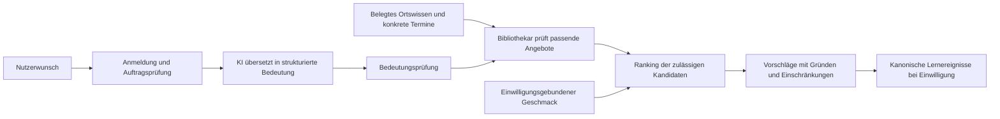

# Aktueller Ablauf der Backyrd Decision Engine

Stand: 2. November 2026. Dieses Dokument beschreibt den aktiven Produktpfad für
Weiterentwicklung, Prüfung und die sachliche Erklärung gegenüber Investoren.

## Produktprinzip

Backyrd verbindet einen in natürlicher Sprache beschriebenen Wunsch mit
strukturiertem Ortswissen und optional dem persönlichen Geschmack. Die KI
übersetzt den Wunsch. Die Software prüft belegte Angebote, Bereiche, Regeln und
Verfügbarkeit. Erst unter den passenden Kandidaten wirkt die Personalisierung.
Die KI recherchiert dabei keine neuen Ortsbehauptungen und bestimmt nicht frei
eine Rangliste aus ihrem allgemeinen Wissen.

## Produktionsstand

| Bestandteil | Verifizierter Stand |
| --- | --- |
| Funktionaler Release | `053e684a25e0e0c7cf227da4437f01233a19a55f`, PR 671 |
| Zugehöriger Release-Nachweis | Main `b7d263fb39ed9b9bb16290b7dc565c737d82cb35`, PR 672 |
| Aktiver Transport | `decision-v13`, Version 232; JWT-Prüfung aktiv |
| Admin-Diagnose | `decision-admin-diagnostic`, Version 28; JWT- und Admin-Prüfung |
| Runtime | Generation 49, ON; Kontinuitätsautorisierung bestätigt |
| Modell | `gpt-5.6-luna`, Reasoning `low`, Responses API |
| Provider | `backyrd.luna-provider@5` |
| Prompt | `backyrd.luna-prompt@29` |
| Bedeutungsauftrag | `backyrd.decision-vnext.librarian-request@1` |
| Matching | `backyrd.decision-vnext.librarian-matching@53` |
| Evaluatoren | Orte `decision-vnext-librarian-evaluator@11`, Events `@12` |
| Kontext | Basel-Region über `backyrd_decision_vnext_product_context_v7` |

Der Sicherheitsrelease vom 2. November (`81f25c6b6ee147b4f97ac66498343c5f7030976f`,
Produktionslauf 41404437996) verändert weder die Engine noch ihre Interpretation
oder ihr Ranking. Alle 30 Edge-Function-Versionen, Bundle-Hashes und JWT-Einstellungen
sind vor/nach diesem Release identisch; oben stehen die am 2. November tatsächlich
abgelesenen Function-Versionen. Generation 49 ist weiterhin ON.
Das veröffentlichte iOS-Sicherheitsupdate ist `01a198c8-d127-7a47-88a0-1e59ded947ea`,
Gruppe `4dea6585-ac77-4b43-9435-015029d05341`, Runtime 1.1.0, Quellstand
`9b04fd2651c185de26694d5a1763b6398e84f91b`. Es wurde am öffentlichen Produktionsendpunkt
bytegenau mit dem zertifizierten Hermes-Paket abgeglichen; das ist keine
Bestätigung einer Installation auf einem konkreten Gerät.

Die spätere Dokumentationsänderung ist keine neue Engine-Version. Historische
Phase-/Lab-Berichte beschreiben frühere Zustände; ihre damaligen Rankings und
Aktivierungsangaben sind nicht der aktuelle Produktvertrag.

## Ablauf einer Anfrage

### 1 Eingabe und Suchkontext

Die App erzeugt den typisierten Produktauftrag aus Freitext, gegebenenfalls
expliziten Bedienelementen sowie Anfrage- und Idempotenz-IDs. Besuchsdatum,
Budget, Gruppengrösse oder Alter aus Bedienelementen dürfen bei der Übersetzung
nicht verschwinden. Ein aus Profil oder Gerät gewählter Suchort ist ein
Suchkontext und nicht automatisch ein zusätzlich vom Nutzer ausgesprochener
Ortszwang. Referenzzeit und Zeitzone werden serverseitig gebunden.

### 2 Anmeldung und Ausführungsschutz

Der HTTP-Handler akzeptiert den Produktaufruf über den bestehenden Transport.
Er prüft Bearer-Anmeldung, Actor-/Sitzungsbindung, Request-Schema, Grösse,
Runtime-Identität und den konfigurierten Missbrauchsschutz. Der Client liefert
keine vertrauenswürdige Nutzerprojektion und kann keine Serverberechtigung
oder Ranking-Regel setzen. Es gibt keine produktive Founder-Account-Freigabeliste.

Vor und nach asynchronen Verarbeitungsschritten wird der Ausführungszustand
geprüft. Ein zwischenzeitlich abgeschalteter Runtime-Stand darf kein bereits
erzeugtes Ergebnis mehr ausliefern. Ein gemeinsames Abbruchsignal begrenzt die
Verarbeitung einschliesslich externer Aufrufe.

`vnext-only.ts` enthält konfigurierbare Standardwerte: 20 Sekunden Gesamtbudget,
16 KiB Request, 20 Anfragen je Subjekt/Minute, 500 je Subjekt/Tag sowie globale
Grenzen von 300/Minute und 20 000/Tag. Diese Zahlen sind Code-Defaults;
Produktionskonfiguration kann sie überschreiben. Die aktuelle wirksame
Kontingenthöhe wurde für dieses Dokument nicht aus Secrets ausgelesen.

### 3 Wiederholung derselben Ausführung

Die Idempotenz schützt wiederholte Übertragungen derselben Anfrage gegen
abweichende oder doppelte Verarbeitung. Ein vorhandenes gültiges Ergebnis
wird nach erneuter Autoritätsprüfung wiedergegeben. Andere Eingaben unter
derselben Idempotenz-ID sind ein Konflikt. Das ist kein allgemeiner Cache für
inhaltlich gleiche Sätze unter neuen Anfrage-IDs.

### 4 Luna übersetzt den Wunsch

Der normale Pfad verwendet einen strukturierten Modellaufruf. Das Schema enthält
Entitäten, Fakten, Logik, Bindungen, Erweiterungen, Unsicherheiten und
Wetterbedingungen. Fakten unterscheiden Pflicht, Wunsch, Ausschluss,
ausdrücklich nicht nötige Bedingung und Kontext. Bezugspersonen und Bezug zum
konkreten Angebot bleiben erhalten.

„Aktivität mit Essen oder Snacks“ enthält eine Aktivität und eine Alternative
für die zusätzliche Verpflegung. Es bedeutet weder drei zwingende Aktivitäten
noch eine Pflicht, gleichzeitig Essen und Snacks zu konsumieren. Alter und
Begleitung werden der passenden Person zugeordnet. Ein qualitativer Preiswunsch
wird nicht zu einer erfundenen Frankenobergrenze.

Das Modell bekommt den versionierten Bedeutungskatalog und die Referenzzeit,
aber keine vollständige private Nutzerakte oder Zugangsdaten. Der Provider
setzt `store:false` und höchstens 7500 Ausgabetokens. Daraus folgt keine Zusage
über sämtliche Aufbewahrungsregeln des externen Anbieters.

### 5 Bedeutungsprüfung und begrenzte Korrektur

Modelloutput ist unzuverlässiger Input bis zur Schema-, Referenz-, Quellen- und
Bedeutungsprüfung. Die Software prüft insbesondere falsche Familienzuordnung,
unbelegte Präferenzen und verlorene explizite Angaben. Sie darf eine Pflicht
nicht stillschweigend abschwächen oder einen unklaren Begriff erfinden.

Bei dafür definierten Bedeutungsfehlern ist höchstens ein begrenzter
Korrekturaufruf erlaubt. Welche Felder verändert werden dürfen, wird überprüft;
alle anderen Inhalte und Bindungen müssen erhalten bleiben. Für HTTP
502/503/504 gibt es zusätzlich einen gemeinsamen einmaligen Transport-Retry
innerhalb desselben Zeitbudgets. Ablehnung, kaputte Struktur oder verbleibende
Bedeutungsfehler führen zu einem nachvollziehbaren Fehler, nicht zu einer
vermeintlich erfolgreichen leeren Empfehlung.

Eine neue Anfrage kann trotz identischem Freitext eine neue Modellübersetzung
erzeugen. Die Verträge begrenzen diese Variabilität; sie beweisen keine
universelle Sprachzuverlässigkeit. Wiederholungstests gehören zur Abnahme.

### 6 Das kanonische Ortswissen wird geladen

Der serverseitige Adapter lädt aktuelle World-Snapshots, die erlaubte
Nutzerprojektion und gegebenenfalls Event-Vorkommen. Für Basel als Suchkontext
kann der freigegebene regionale Katalog über Kontext v7 geladen werden.
Ein ausdrücklich gewünschter Ort und der regionale Suchkontext werden dabei
unterschieden. Die freigegebenen Gemeinden stehen in
`product-librarian-geography.ts`.

Eine bereits typisierte Suchstadt kann nach Anmeldung und Missbrauchsschutz
einen vorgezogenen, an dieselbe Anfrage gebundenen Kontextabruf starten. Das
liest keine neue Absicht aus Freitext und ist kein gemeinsamer Nutzercache.

Der historische RPC-Parameter `EAT` ist in diesem Pfad ein Transportwert für den
Katalogabruf. Er wird nicht als Essenspflicht in die eigentliche Anfrage
eingetragen. Die Bewertung erhält den vollständigen freigegebenen Katalog,
nicht eine vom Modell frei behauptete Liste passender Restaurants.

### 7 Der Bibliothekar prüft zusammengehörige Belege

Die Software verbindet den Bedeutungsauftrag mit dem versionierten
World-Katalog. Sie prüft Angebote und ihre verknüpften Bereiche, statt alle
Eigenschaften eines Ortes beliebig zusammenzumischen. Ein günstiges Getränk
beweist kein günstiges Abendessen. Eine Altersgrenze eines Sportangebots darf
eine eigenständige Kinderaktivität nicht ausschliessen. Pflicht, Alternativen,
Wunsch und Kontext bleiben getrennt.

Die Prüfung unterscheidet bestätigte Erfüllung, Widerspruch und fehlendes
Wissen. Ein unbekanntes Kinderalter erzeugt nicht automatisch einen Ausschluss;
bekannte Altersregeln müssen entsprechend ihrer Bedeutung angezeigt oder
beachtet werden. „Alle Altersgruppen“ umfasst auch Kinder. Fehlende
Angebots-/Bereichszeiten verwenden den festgelegten allgemeinen Zeitbezug des
Ortes als Rückfall; unbekannte Zeiten werden nicht als nachgewiesene Öffnung
oder Schliessung erfunden.

Ein blosses Tier-, Essens- oder Kindermenümerkmal beweist nicht beliebig eine
Tieraktivität, einen Restaurantbesuch oder eine Familienaktivität. Zulässige
Synonyme und Bedeutungsbeziehungen sind versionierte Software-/Katalogregeln.
Ausdrückliche Pflichtverletzungen werden vor dem Ranking ausgeschlossen.

### 8 Events werden nach dem konkreten Termin geprüft

Wenn der Auftrag Events einschliesst, werden deren konkrete Vorkommen als
eigene Kandidaten bewertet. Platz, Innen-/Aussenbereich, Tag und Zeiten müssen
zusammenpassen. Die Herbstmesse ist eine Jahresausgabe mit sieben Schauplätzen
und 114 Tagesintervallen, keine Sammlung von 114 eigenständigen Veranstaltungen.

Passende Event-Vorkommen werden nach der Prüfung auf eine Empfehlung je
Veranstaltung zusammengefasst. Die App-/Web-Übersichten gruppieren saisonale
Ausgaben ebenfalls; Standorte und Tageszeiten stehen im Detail. Familiengeeignet
belegt keine Freigabe sämtlicher Fahrgeschäfte für jedes Alter.

### 9 Rangfolge und Ausgabe

Der finale Comparator ist deterministisch und lexikografisch: Das erste
unterschiedliche Kriterium entscheidet. Es gibt hier keine frei generierte
KI-Gesamtnote und keinen Einfluss durch Zahlungen eines Owners.

| Reihenfolge | Kriterium |
| --- | --- |
| 1 bis 3 | Harte Bedingungen, Eignungsklasse und bestätigte Hauptabsicht |
| 4 bis 6 | Zusätzlich bestätigter Hauptzweck, Zahl offener Pflichtangaben und Verfügbarkeit |
| 7 bis 11 | Nebenabsicht, Besuchssituation, weitere Wünsche, Atmosphäre und Tageszeit |
| 12 bis 13 | Einwilligungsgebundene persönliche Passung und deren Evidenzstärke |
| 14 bis 15 | Widerspruchsfreie Ortsbelege und zusätzliche bestätigte Gründe |
| 16 | Neutraler stabiler Hash als letzter Gleichstandsentscheid |

Unabhängig vom Comparator werden nur bestätigte Kandidaten ohne offene oder
verletzte harte Bedingungen und ohne situativen Ausschluss gerankt.
Personalisierung kann diese Grenze nicht überstimmen. Die Hauptantwort ist auf
ein begrenztes Fenster von höchstens acht Kandidaten und den Antwortumfang
beschränkt. Weniger sichtbare Treffer bedeuten deshalb nicht zwingend weniger
passende Kandidaten im gesamten Katalog.

Gründe, Einschränkungen, Belegbindungen und Ranking-Vektoren werden aus der
geprüften Bewertung erstellt. Ein rein technischer Gleichstandsentscheid darf
nicht als bessere persönliche Passung erklärt werden.

## Profil und Learning

Die aktive Projektion unterscheidet direkte positive/negative Ortsbeziehungen
und persönlich passende World-Konzepte. Ihre Wirkung kommt nach situativer
Eignung. Ohne aktive Einwilligung bleibt die Nutzerprojektion neutral und
Decision nutzbar.

Die Decision schreibt ausschliesslich kanonische Lernereignisse über den
zuständigen User-Intelligence-Port. Request, Alternative, kontextueller Reject,
Impression und Öffnen sind unterschiedliche Signale. „Weitere Vorschläge“ ist
kein negatives Urteil über den vorherigen Ort. Wiederholte Übertragung darf
kein mehrfaches Learning erzeugen. Diagnoseaufrufe sind keine persönlichen
Nutzerinteressen. Dies ist Profil-/Ereignisverarbeitung und kein fortlaufendes
Training der Gewichte des externen Sprachmodells.

## Wetter und weitere Grenzen

Wetter aus einer Nutzerangabe wird als solche behandelt. Eine Aussage „Es regnet“
ist keine verifizierte Wettervorhersage. Echte Wenn-dann-Wetterzweige sind von
diesem Kontext getrennt. Der aktuelle Pfad beweist keine angebundene aktuelle
Wetter- oder ÖV-Datenquelle; diese Integrationen gehören in den Beta-Arbeitsplan.

Die belegten internen und Live-Testanfragen zeigen funktionierende Fälle, keine
Fehlerfreiheit für jede denkbare Formulierung. Die letzte Herbstmesse-
Veröffentlichung ist über Backend, öffentliche Detailseite und iOS-Manifest
bestätigt. Ihre drei Suchfälle bestanden intern; die Wiederholung nach Release
blieb durch die stockende Browser-Steuerung offen. Der Founder bestätigte danach,
dass die zusammengefasste Herbstmesse-Darstellung auf dem iPhone aktiv ist.

## Nachvollziehbarkeit und Schutz

Eine Ausführung ist an Request, Sitzung, Kontext, World-Snapshots, Schema-/Prompt-
Version, Release und Quellhashes gebunden. Die normale Betriebsdiagnostik
protokolliert feste Fehlercodes und Laufzeiten statt Freitext, Tokens oder
privater Profile. Die geschützte Admin-Diagnose kann zusätzliche
Übersetzungs-/Ausschlussdetails für die Prüfung bereitstellen.

Server-, Berechtigungs-, Modell- und Netzwerkfehler sind von einem korrekt
berechneten Ergebnis ohne passende Orte zu unterscheiden. Der aktive Pfad
weicht bei Fehlern nicht auf eine alte Engine oder erfundene Empfehlung aus.
Für einen neuen Release müssen die tatsächlichen Modell-/Matching-/Daten- und
Geräteprüfungen zu dessen Identität passen.

## Erklärung für einen Investor Pitch

Backyrd übersetzt persönliche Wünsche in einen strukturierten Suchauftrag und
gleicht diesen mit eigenem, belegtem Orts- und Erlebniswissen ab. Die Auswahl
berücksichtigt konkrete Angebote, Zeit, Gesellschaft und Atmosphäre; freiwillige
Personalisierung ordnet die bereits passenden Möglichkeiten. Entscheidungen
lassen sich bis zu den zugrunde liegenden Angaben nachvollziehen.

Der eigenständige Produktwert liegt im strukturierten Wissen, der gemeinsamen
Bedeutungssprache, der Prüfung zusammengehöriger Bedingungen und dem
einwilligungsgebundenen Erfahrungsprofil. Das eingesetzte Sprachmodell ist ein
externer Dienst. Behauptungen über ein selbst trainiertes Foundation Model,
fehlerfreie Interpretation, bewiesene Nutzerbindung oder garantierte
Geschäftsergebnisse sind durch diesen technischen Stand nicht gedeckt.

## Kanonische Implementierung und Release Belege

- Transport: `supabase/functions/decision-v13/vnext-only.ts`.
- Provider und Bedeutungsauftrag: `product-luna-provider.ts`,
  `product-luna-librarian.ts`, `product-luna-meaning-contract.ts` und die
  eingefrorenen `product-luna-librarian-assets.ts` im Core-Paket.
- Datenabruf und Profilprojektion: `product-decision-production-adapter.ts`.
- Suche und Bewertung: `product-librarian-plan.ts`,
  `product-librarian-matching.ts`, `product-librarian-evaluator.ts`,
  `product-librarian-language.ts` und `product-event-candidates.ts`.
- Reihenfolge, Ausgabe, Idempotenz und Learning: `product-decision.ts`.
- User-Learning-Vertrag:
  `packages/user-intelligence-vnext-core/src/product-decision-learning.ts`.
- Runtime- und Migrationsnachweis: `delivery/production-state.json`,
  `supabase.seasonalEventRelease`.
- Zertifizierung: [GitHub-Lauf 41330873126](https://github.com/PhiluLan/backyrd/actions/runs/41330873126).
- Produktionsdeployment: [GitHub-Lauf 41331498101](https://github.com/PhiluLan/backyrd/actions/runs/41331498101).

Release-Manifest `db4ea24eb9a037ded14fe90f2eb9562b79230a3e0265ea970742f01481e46f87`,
Runtime-Artefakt `7a2cf16abfbf4778f70df770fddf4f06e77a9263060a6bdfe946c00bd6aee749`,
Decision-Quellstand `61d39b6fa73456a085e81baaac79394c96dda517febda5c36f2be9491c7752dd`.
